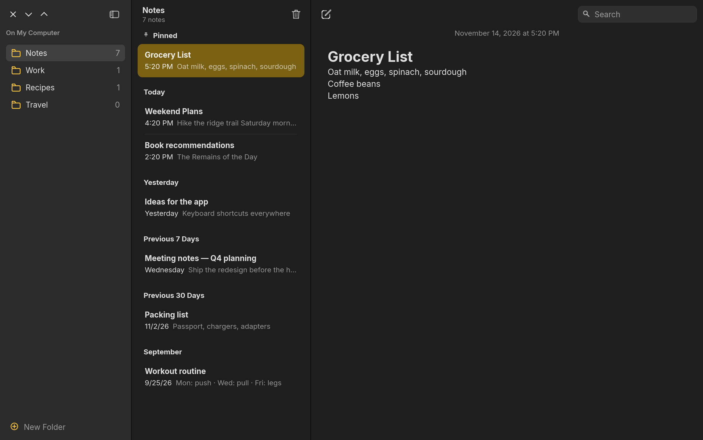

# y7ya-os

My own Mac-inspired desktop for Linux, and the apps that live in it. Faithful to
macOS where it matters (windows, Mission Control, the little details), without the
parts I don't want (no Dock), and light on battery: everything renders only when
something changes.

| Path | What |
|---|---|
| `desktop/` | **The desktop**: a Wayland compositor in Rust (Smithay) with Mac-style windows |
| `apps/notes/` | **Notes** for the desktop, on our own GPU UI framework |
| `apps/calendar/` | **Calendar**: day, week, month and year views, synced peer to peer |
| `apps/reminders/` | **Reminders**: smart lists, subtasks, due dates, synced peer to peer |
| `android/` | **Notes for Android** (Kotlin + Compose), synced peer to peer |
| `crates/ui/` | The tiny GPUI-style UI framework every app is built on |
| `crates/y7-sync/` | Device-to-device sync for every app (Automerge + iroh) |
| `crates/y7-syncd/` | The sync daemon: one identity and set of paired devices per computer |
| `crates/sync-ui/` | The shared "Sync with Phone" row and pairing sheet |
| `crates/*-core/` | Each app's document (notes, calendar, reminders) |
| `crates/notes-ffi/` | The Notes core, exposed to Kotlin via UniFFI |

**Roadmap:** Mission Control + spaces on a 3-finger swipe · app switcher · Spotlight ·
notifications + Control Center · lock screen · Files · Calculator · Preview / Quick Look ·
TextEdit · Screenshot · Clipboard history · Windows-style Task Manager · Calendar and
Reminders on Android · FileDrop to Android · an AI helper (Claude or Codex) instead
of a Settings app.

## Desktop

```sh
cargo run --release -p y7-desktop -- -c konsole   # nested, in a window on your current desktop
```

Windows get a macOS-style title bar drawn by the compositor (traffic lights that show
their glyphs on hover, centered title, active/inactive states), large rounded corners
and soft two-layer shadows; new windows fade and zoom in. Drag the title bar to move,
double-click it to zoom, drag any edge to resize.

| Shortcut | Action |
|---|---|
| Super+Q / Super+W | Close window |
| Super+M / Super+Shift+M | Minimize / bring back the last minimized window |
| Super+F | Zoom (fill the screen) |
| Super+Tab | Next window |
| Super+Return / Super+E | Terminal / file manager |
| Ctrl+Alt+Backspace | Quit the desktop |

`y7-desktop --headless 1440x900` renders offscreen and takes scripted input on stdin
(`spawn`, `move`, `click`, `key super+m`, `shot file.png`, ...), which is how the
desktop is tested without touching a real screen.

# Notes

A lightweight, Apple Notes–style notes app, written in Rust on a tiny
GPUI-inspired UI framework built from scratch for it, plus an iPhone Notes–style
Android app. The two sync directly with each other: no account, no server.



- **Small and fast**: a single ~15 MB binary, first frame in about 0.1 s, about 50 MB
  of RAM, 0% CPU when idle (it only redraws when something changes).
- **Seamless window**: no title bar. The app draws your desktop's window buttons
  in its own header, in the order set in KDE's `kwinrc`.
- Folders, pinned notes, search, Recently Deleted (kept for 30 days), undo/redo,
  light and dark themes (follows the system).
- **Syncs with your Android phone**, peer to peer and end-to-end encrypted (see below).
- Notes autosave as they sync: the notebook lives with the sync daemon (see below).

## Build and install

```sh
cargo build --release -p notes -p calendar -p reminders -p y7-syncd
for app in notes calendar reminders; do
    install -Dm755 target/release/$app ~/.local/bin/$app
    install -Dm644 apps/$app/$app.desktop ~/.local/share/applications/$app.desktop
done
install -Dm755 target/release/y7-syncd ~/.local/bin/y7-syncd
install -Dm644 crates/y7-syncd/y7-syncd.desktop ~/.config/autostart/y7-syncd.desktop
```

Needs a GPU with Vulkan (falls back to OpenGL ES). Tested on KDE Plasma (Wayland).

## Android app

`android/` is a native Kotlin + Jetpack Compose app laid out like iPhone Notes
(folders, date-grouped notes, swipe actions, a bold first-line title). It shares
the Rust core with the desktop app through [UniFFI](https://mozilla.github.io/uniffi-rs/).

```sh
cd android
./build-rust.sh            # builds the core for Android, generates Kotlin bindings
./gradlew assembleRelease  # app/build/outputs/apk/release/app-release.apk
```

Needs JDK 21, the Android SDK + NDK and [`cargo-ndk`](https://github.com/bbqsrc/cargo-ndk).
Release builds are signed with the key in `android/keystore.properties` (see the
`.example`), or the debug key if there isn't one.

## Sync

On the computer click **Sync with Phone** (bottom left in Notes, Calendar or
Reminders) and scan the QR code from the phone app (**Sync with Computer**). Pairing
is per computer, not per app: pair once and every app syncs. After that the devices
sync whenever both are on, usually within a fraction of a second.

- **No cloud.** Devices connect directly with [iroh](https://iroh.computer): on the
  same Wi-Fi via mDNS, otherwise via UDP hole punching. If no direct path exists,
  traffic goes through one of n0's public relays, which only ever see encrypted
  bytes. Nothing is stored anywhere but your devices, so both need to be online
  at the same time to sync.
- **Secure.** Each device has its own Ed25519 key; connections are QUIC + TLS 1.3
  authenticated by those keys, and a device only talks to the keys it paired with.
  The QR code holds a one-time secret that expires after 10 minutes.
- **No lost edits.** Notes live in an [Automerge](https://automerge.org) document,
  a CRDT: edits made on both devices while apart, even to the same note, merge
  character by character.

- **One daemon, every app.** `y7-syncd` owns the device key, the paired devices and
  all synced documents (`~/.local/share/y7-sync/`), and talks to one connection per
  peer that carries every document (`notes`, `calendar`, `reminders`), each frame
  tagged with its document id (`y7/sync/2`). Phones from before still speak
  `notes/sync/1` and keep syncing notes. Apps keep an in-memory copy of their
  document and sync it with the daemon over `$XDG_RUNTIME_DIR/y7-sync.sock` with the
  same Automerge protocol. The daemon starts with your session
  (`crates/y7-syncd/y7-syncd.{socket,service}` for systemd, or the autostart
  `y7-syncd.desktop`), or on demand when an app needs it; with nothing paired it
  doesn't touch the network at all. Its first start moves Notes' key, paired phone
  and notebook over from `~/.local/share/notes/`.
- `y7-syncd status` lists paired devices; `y7-syncd pair <code>` pairs with a
  device showing a code (e.g. another computer).

`crates/y7-sync` is the sync engine (the Android app runs it in-process through
`crates/notes-ffi`); `crates/notes-core` is the notebook on top of it.
`cargo run -p notes-core --example peer -- <dir>` runs a headless device for testing.

## Keyboard shortcuts

| Shortcut | Action |
|---|---|
| Ctrl+N | New note |
| Ctrl+Shift+N | New folder |
| Ctrl+F | Search |
| Ctrl+Z / Ctrl+Y | Undo / redo |
| ↑ / ↓, Delete | Move through / delete notes (when the list is focused) |
| Ctrl+S | Save now |
| Ctrl+W / Ctrl+Q | Close |

## How it's built

`crates/ui` is a ~3,000-line immediate-mode UI framework in the spirit of
[GPUI](https://www.gpui.rs): the element tree is rebuilt every frame, laid out with
[taffy](https://github.com/DioxusLabs/taffy) flexbox, and drawn on the GPU by
[wgpu](https://wgpu.rs) with a single instanced pipeline (SDF rounded rects,
shadows, line icons and glyphs from an atlas). Text shaping and editing use
[cosmic-text](https://github.com/pop-os/cosmic-text); windowing uses
[winit](https://github.com/rust-windowing/winit).

`apps/notes` is the desktop app itself: the views, theme and icons, on top of the
shared notebook in `crates/notes-core`.

`notes --snapshot out.png [--light]` renders the UI with sample data offscreen.

## Fonts

Bundles [Inter](https://rsms.me/inter/) under the SIL Open Font License
(`assets/fonts/OFL.txt`).
